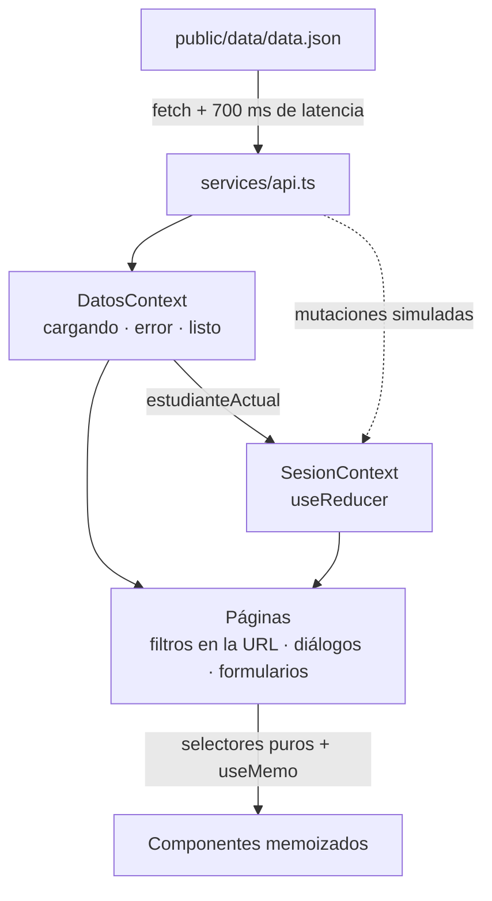

# Comunidad UTalca · Emprendimientos y Grupos Intermedios

Aplicación web, pensada primero para el teléfono, que reúne dos módulos para estudiantes de la Universidad de Talca:

- **Emprendimientos estudiantiles:** catálogo con filtros, "me gusta", favoritos, reseñas con estrellas y contacto directo.
- **Grupos intermedios:** directorio con filtros, "Mis grupos", solicitud de información e inscripción.

**Demo:** https://pruebatecnica-umber.vercel.app

## Cómo ejecutarlo

Requiere Node 22 o superior.

```bash
npm install
npm run dev      # http://localhost:5173
npm test         # 24 pruebas de la lógica (Vitest)
npm run build    # chequeo de tipos + build de producción
npm run lint     # Oxlint
```

## Stack y por qué

| Pieza | Elección | Motivo |
|---|---|---|
| UI | React 19 + TypeScript estricto | El documento menciona React. Los modelos y las acciones del reducer quedan tipados, así que los errores de estado se detectan al compilar. |
| Build | Vite 8 | Arranque inmediato y sirve `public/` para el `fetch` del JSON. Next.js no aportaba nada: no hay SSR ni servidor. |
| Rutas | React Router 8, modo declarativo | El detalle necesita botón "atrás" (clave en Android) y enlaces directos. |
| Estado global | Context API + `useReducer` | Es lo que pide el enunciado. El reducer es una función pura que se prueba sin React. |
| Estilos | CSS Modules + tokens en variables CSS | Vienen con Vite, no suman dependencias y dejan los estilos acotados a cada componente. |
| Modales | `<dialog>` nativo | El navegador ya resuelve el foco atrapado, el cierre con Esc y el fondo inerte, sin librerías. |
| Confirmaciones | Sonner | Toasts accesibles con una sola dependencia. |
| Iconos | Font Awesome (paquetes SVG de React) | Incluye los logos de WhatsApp e Instagram. Con imports individuales, el bundle solo lleva los iconos que se usan. |
| Pruebas | Vitest (entorno node) | Cubre la lógica pura: reducer, selectores y validaciones. |
| Backend | Ninguno | Da el mismo puntaje base. Una capa de servicios simula la API con latencia; pasar a una API real solo cambia `src/services/api.ts`. |

## Arquitectura



```
src/
  services/api.ts        Única puerta a los datos: carga con caché, latencia y mutaciones simuladas
  state/                 DatosContext (carga), SesionContext + sesionReducer (lo que hace el estudiante)
  lib/                   Lógica pura: selectores, validaciones, contacto, formato, tonos
  hooks/useFiltrosUrl.ts Filtros de las listas guardados en la URL
  features/              emprendimientos/ y grupos/: páginas, filas y diálogos de cada módulo
  components/            UI compartida, una carpeta por componente con su .tsx y su .module.css
    Dialog/              Dialog.tsx + Dialog.module.css
    Layout/  Tabs/  BarraFiltros/  Estados/  EstrellasInput/  Calificacion/  Mosaico/  PaginaLista/
  styles/                tokens.css (diseño) y global.css (base y primitivas)
```

Los módulos de `features/` no se importan entre sí: lo que comparten vive en `components/`, `lib/` y `state/`.

Regla de dependencias: los componentes no conocen los servicios. Hay una excepción deliberada: los formularios que no modifican estado global (enviar un mensaje, pedir información) llaman directamente al servicio.

## Gestión del estado

**Principio: datos del "servidor" (inmutables) + cambios de la sesión + valores derivados.**
El JSON es la foto que entregó el servidor y nunca se modifica. La sesión guarda solo lo que hace el estudiante. Todo lo demás se calcula. Así no hay datos duplicados ni nada que sincronizar.

| Estado | Dónde vive | Por qué |
|---|---|---|
| Estado de carga, `estudianteActual`, campus, emprendimientos, grupos | `DatosContext` | Datos remotos que comparten todas las vistas. Se cargan una vez y pueden fallar. |
| `favoritosIds`, `likesIds`, `valoracionesNuevas`, `gruposInscritosIds` | `SesionContext` (`useReducer`) | Representan la sesión del estudiante y los usan varias vistas. |
| Búsqueda, categoría o temática, campus, pestaña activa | URL de cada página (`useSearchParams`) | Es estado efímero de la vista, no global, pero así sobrevive a ir al detalle y volver con "atrás". |
| Texto que se está escribiendo | `useState` dentro de `useFiltrosUrl` | El router actualiza la URL de forma asíncrona; un input leído directamente de ella perdería letras. |
| `isOpen` de los diálogos, grupo seleccionado | `useState` en la página que los abre | Solo le importa a esa vista. |
| Valores, errores y `enviando` de cada formulario | `useState` dentro del formulario | Pertenecen al ciclo de vida del formulario. |
| Estrella resaltada al pasar el puntero | `useState` en `EstrellasInput` | Es puramente visual. |
| Lista filtrada, contadores de likes, promedio, total de reseñas, cupos, miembros | **No se guardan**: se derivan con selectores puros + `useMemo` | Guardarlos sería duplicar datos y arriesgar que queden desfasados. |

Detalles de diseño:

- **`SesionProvider` solo se monta con los datos listos.** El reducer nace con los IDs del estudiante mediante la inicialización diferida de `useReducer`, sin un `useEffect` de sincronización.
- **Dos contextos separados por ciclo de vida, no por dominio.** Los datos se cargan una vez y pueden fallar; la sesión cambia con cada toque. No se divide por módulo porque, con rutas, solo hay una vista montada a la vez.
- **Acciones asíncronas en el contexto** (publicar una reseña, inscribirse): primero esperan al servicio y luego despachan. El componente que las llama maneja su propio indicador `enviando`.
- **El único `useEffect` de la app es el de la carga de datos.** Es su uso legítimo: sincronizar con algo externo, la red.

Derivaciones principales (`src/lib/selectores.ts`):

```
likes   = likes del JSON − (like inicial ? 1 : 0) + (like actual ? 1 : 0)
reseñas = nuevas de la sesión + las del JSON → promedio y total se recalculan solos
cupos   = cupos del JSON − (inscrito en esta sesión ? 1 : 0)
puedeInscribirse = no es miembro y cupos > 0
```

## Optimización

- **Estado derivado en lugar de guardado:** no hay efectos de sincronización ni renders de más.
- **Filas con `React.memo`, props simples y acciones estables** (memoizadas sobre `dispatch`). Un "me gusta" vuelve a renderizar solo esa fila, no las otras 163.
- **`useMemo`** para listas filtradas, opciones de filtro y mapas de campus. **`useDeferredValue`** en la búsqueda, para que el input no se trabe al escribir.
- **`content-visibility: auto`** en las filas: el navegador no pinta las que están fuera de pantalla.
- **Un solo `<dialog>` por tipo y por página** (no 54), con un callback estable para abrirlo.
- **La promesa de carga queda en caché**, así que no hay doble petición aunque `StrictMode` monte todo dos veces en desarrollo. Si falla, la caché se borra para que "Reintentar" vuelva a pedir.
- **Las animaciones usan solo `transform` y `opacity`**, y respetan `prefers-reduced-motion`.

## Requisitos y dónde se cumplen

| Requisito | Implementación |
|---|---|
| A1 Catálogo con filtros por categoría, campus y texto, más "Mis favoritos" | `EmprendimientosPage`, `filtrarEmprendimientos`. La búsqueda ignora mayúsculas y tildes. |
| A2 "Me gusta" con contador inmediato y favoritos | `sesionReducer` (`TOGGLE_LIKE`, `TOGGLE_FAVORITO`), `contarLikes` |
| A3 Promedio, lista de reseñas y nueva reseña de 1 a 5 estrellas con recálculo | `ValoracionForm`, `EstrellasInput`, `resumenValoraciones` |
| A4 Contacto por WhatsApp, Instagram o correo, y modal de mensaje | `canalesDeContacto`, `ContactoDialog` |
| B1 Directorio con temática, campus, horario, lugar, cupos y requisitos | `GruposPage`, `GrupoFila`, `filtrarGrupos` |
| B2 "Mis grupos": iniciales del JSON más inscripciones de la sesión | Pestaña "Mis grupos", insignia "Eres miembro" y filo de color |
| B3 Solicitud de información en cualquier grupo | `SolicitudInfoDialog` |
| B4 Inscripción solo si no es miembro y hay cupos | `InscripcionDialog`, `estadoGrupo().puedeInscribirse` |
| Carga asíncrona simulada | `services/api.ts` |
| Estados de carga, error y vacío; confirmaciones; validación | `Estados.tsx`, toasts de Sonner, `lib/validaciones.ts` |
| 100 % responsiva | Primero el teléfono: navegación inferior bajo 1024 px y barra lateral desde 1024 px |

## Hallazgos del `data.json` y supuestos

Revisé el archivo con un script antes de diseñar:

- `promedio_valoracion` y `total_valoraciones` coinciden con `valoraciones[]` (0 discrepancias). Son redundantes: la app los **deriva** de la lista.
- 16 emprendimientos no tienen reseñas. Se muestra "Sin reseñas", no "0,0".
- Muchos contactos vienen en `null` (88 sin correo, 67 sin teléfono, 40 sin Instagram). Solo se muestran los canales que existen.
- 35 usuarios de Instagram tienen tildes (por ejemplo `@rincóndelapunte_3`). Se codifican en la URL.
- `campus_ids` es un arreglo en emprendimientos, mientras que `campus_id` es un valor único en grupos.
- 10 grupos no tienen `lugar_reunion`. Se muestra "Por confirmar".
- `grp_09` tiene 0 cupos y el estudiante ya es miembro: "Eres miembro" tiene prioridad sobre "Sin cupos".
- Las fechas `AAAA-MM-DD` se interpretan como fecha local: `new Date("2026-10-06")` usa UTC y en Chile mostraría el día anterior.

Supuestos:

1. El `likes` del JSON **incluye** el like inicial del estudiante. Quitarlo en `emp_001` deja el contador en 11 (12 − 1).
2. Inscribirse descuenta 1 cupo y suma 1 miembro. La capacidad del grupo es miembros + cupos libres, y se usa para la barra de ocupación.
3. El teléfono registrado de un emprendimiento se usa para WhatsApp.
4. "Sesión" significa la vida de la pestaña: no hay persistencia, y al recargar se vuelve al estado del JSON.
5. Un estudiante puede publicar más de una reseña por emprendimiento, porque el enunciado no lo restringe.
6. El envío de mensajes y solicitudes es simulado: espera la latencia y confirma.

## Diseño

- **Identidad visual:** rojo institucional `#c00418` y tipografía Inter, tomados de la hoja de estilos de utalca.cl.
- **Estilo de pantallas de aplicación** ("pastel consumer") con reglas explícitas: sin degradados, sin sombras en elementos en reposo, el color reservado para los datos y la acción principal.
- **Ningún emprendimiento trae fotos.** Por eso cada uno se identifica con sus iniciales sobre el tinte pálido de su categoría. El color refuerza, pero el nombre de la categoría siempre aparece también como texto.
- **Accesibilidad:** todo el texto supera un contraste de 4,5:1. Los toggles usan `aria-pressed`. Las pestañas siguen el patrón WAI-ARIA con flechas del teclado. Las estrellas son radios reales. Los errores van asociados a su campo y el foco pasa al primero. Las zonas táctiles miden al menos 44 px, los inputs usan 16 px para que iOS no haga zoom, y hay un enlace "Saltar al contenido".

## Pruebas

`npm test` ejecuta 24 pruebas sobre la lógica pura:

- **Reducer:** un toggle doble vuelve al estado inicial, el estado no se muta y no se duplican inscripciones.
- **Selectores:** búsqueda sin tildes, campus múltiple, combinación de filtros, delta del like inicial, promedio sin reseñas y el caso de `grp_09`.
- **Validaciones, enlaces de contacto** y fechas sin desfase de zona horaria.

## Con más tiempo

- Persistir la sesión en `localStorage`, con versión del esquema.
- Pruebas de componentes con Testing Library para los flujos completos.
- Actualizaciones optimistas con reversión cuando exista un backend real.
- React Compiler. Lo dejé fuera a propósito para que la memoización fuera explícita y se pudiera evaluar.
